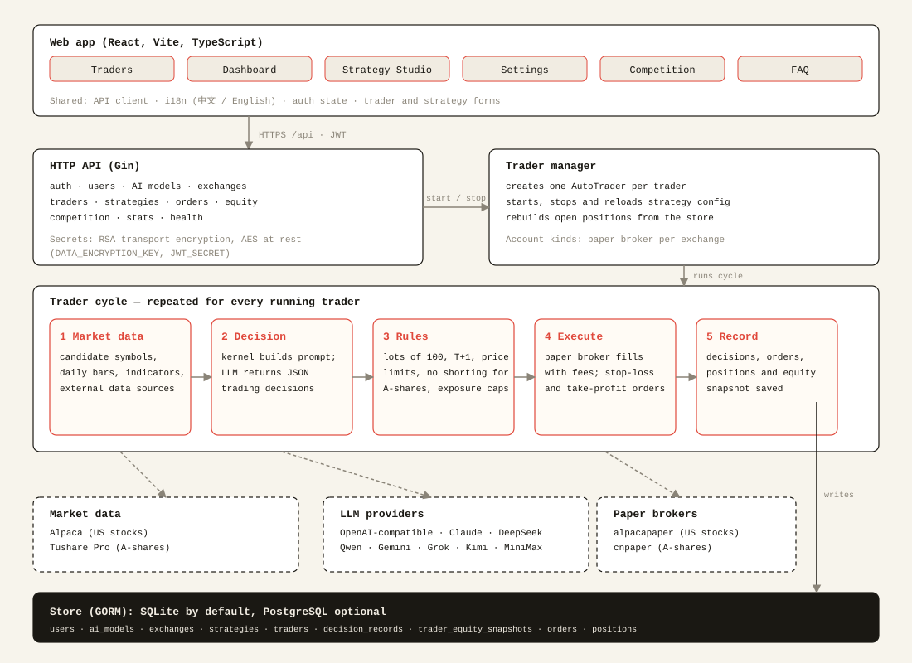

<p align="center">
  
</p>

<br/>

Crux is a self-hosted trading terminal for **US stocks** and **China A-shares**. A language model reads daily market data on each cycle and proposes buy, sell or hold decisions. Before any order is sent, a Go runtime checks the decision against the market's rules: whole lots, T+1 settlement, daily price limits, no shorting for A-shares, and the trading session.

**Status:** paper trading only. US orders go to an Alpaca paper account. A-share orders go to a built-in paper account. A live A-share broker is not connected yet.

## Markets

| Market | Symbols | Currency and clock | Data | Execution |
| :--- | :--- | :--- | :--- | :--- |
| US equities (`us_equity`) | `AAPL`, `BRK.B` | USD, US Eastern | Alpaca daily bars | Alpaca paper account |
| China A-shares (`cn_equity`) | `600519.SH`, `000001.SZ`, `830799.BJ` | CNY, Beijing | Tushare Pro daily bars (forward-adjusted) | Built-in paper account (commission and stamp duty) |

A-share rules the runtime enforces:

- Whole lots of 100 shares. An odd-lot sell is allowed only when it closes the whole position.
- T+1: shares bought today cannot be sold until the next trading day.
- No shorting and no leverage.
- Daily price limits: 10% main board, 20% ChiNext and STAR, 30% Beijing, 5% ST stocks.

US stocks may be shorted and accept fractional quantities. Leverage is not used.

## Quick start

1. Install and open the web app (see [Install](#install)).
2. Register. The first account becomes the owner of the instance.
3. **Add an AI model.** Any OpenAI-compatible endpoint works. Enter the base URL, model name and API key.
4. **Add an exchange account.**
   - For US stocks, choose `alpaca_paper` and enter your Alpaca paper key and secret.
   - For A-shares, choose `cn_paper` and enter your Tushare Pro token.
5. Create a strategy in **Strategy Studio**. Pick the symbols and the risk limits.
6. Create a trader that uses the strategy and the account, then start it.

The dashboard shows the equity curve, open positions, each AI decision with its reasoning, and the daily price for the first open position.

## Configuration

Copy `.env.example` to `.env` and set the required secrets:

| Variable | Purpose |
| :--- | :--- |
| `JWT_SECRET` | Signs login tokens. At least 32 characters. |
| `DATA_ENCRYPTION_KEY` | Base64 32-byte key. Encrypts stored API keys. |
| `RSA_PRIVATE_KEY` | Used for browser-to-server encryption. |
| `ALPACA_API_KEY`, `ALPACA_SECRET_KEY` | Optional server-wide Alpaca market-data keys. |
| `DB_TYPE`, `DB_PATH` | SQLite by default. Set `DB_TYPE=postgres` for PostgreSQL. |
| `EXPERIENCE_IMPROVEMENT` | Set to `false` to turn off anonymous usage statistics. |

Broker and data keys are normally entered in the web app per account, not in `.env`. The Tushare token is entered in the `cn_paper` account.

Paper account state is saved under `data/paper`.

## Install

Clone the repository:

```bash
git clone https://github.com/zsjtiger/nofx.git && cd nofx
```

- **Docker:** see [Docker deployment](#docker-deployment).
- **From source:** see [Local development](#local-development).

**Update:** `git pull`, then `./start.sh start --build` for Docker, or restart the backend and frontend when running from source.

## Local development

Requirements: Go 1.25.11 or newer (the toolchain named in `server/go.mod` is downloaded automatically if needed), Node.js 20 or newer, and Git.

### 1. Create `.env`

```bash
cp .env.example .env
```

Set the three secrets. The server refuses to start without them.

```bash
# JWT_SECRET: any random string of at least 32 characters
openssl rand -base64 48

# DATA_ENCRYPTION_KEY: base64-encoded 32-byte key
openssl rand -base64 32

# RSA_PRIVATE_KEY: a PEM key on one line, with \n for each newline
openssl genrsa -out key.pem 2048
awk 'NF{printf "%s\\n",$0}' key.pem
```

Paste the output into `.env` as `JWT_SECRET=...`, `DATA_ENCRYPTION_KEY=...` and `RSA_PRIVATE_KEY=...`, then delete `key.pem`. `.env` is git-ignored; keep it that way.

### 2. Start the backend

```bash
cd server
go run main.go          # listens on http://localhost:8080
```

`main.go` reads `.env` from `server/` or from the repository root. The first start creates `data/data.db` (SQLite) in the directory it runs from. Equivalent Make target: `make run`.

### 3. Start the frontend

In a second terminal:

```bash
cd web
npm install
npm run dev             # http://127.0.0.1:3000
```

The Vite dev server proxies `/api` to `localhost:8080`, so keep the backend running.

### 4. First use

Open `http://127.0.0.1:3000`, register the first account (it becomes the owner), then follow [Quick start](#quick-start).

### Common tasks

| Task | Command |
| :--- | :--- |
| Run all tests | `make test` (or see [Testing](#testing)) |
| Backend tests only | `cd server && go test ./...` |
| Frontend type check and tests | `cd web && npx tsc --noEmit -p . && npx vitest run` |
| Build the backend binary | `cd server && go build -o crux` (or `make build`) |
| Build the frontend | `cd web && npm run build` (or `make build-frontend`) |
| List Make targets | `make help` |

### Switching the database

SQLite is the default. To use PostgreSQL, set `DB_TYPE=postgres` and `DB_HOST`, `DB_PORT`, `DB_USER`, `DB_PASSWORD`, `DB_NAME` and `DB_SSLMODE` in `.env`.

On startup the server drops columns from the crypto-era schema. Before it changes a SQLite database, it writes a backup named `data.db.bak-<UTC timestamp>` next to the database.

### Troubleshooting

| Message | Fix |
| :--- | :--- |
| `config: JWT_SECRET is required` | Set `JWT_SECRET` in `.env` to a string of at least 32 characters. |
| `failed to load RSA private key` | Set `RSA_PRIVATE_KEY` to one PEM line with `\n` escapes. |
| `failed to load data encryption key` | Set `DATA_ENCRYPTION_KEY` to a base64 32-byte value. |
| Web page shows API errors | Check that the backend is running on port 8080. |

## Docker deployment

Requirements: Docker with Compose v2 (`docker compose`).

The stack has two services:

| Service | Image | Host port | Role |
| :--- | :--- | :--- | :--- |
| `crux` | built from `deploy/docker/Dockerfile.backend` | `CRUX_BACKEND_PORT` (default 8080) | API and trading engine. Data is stored in `./data`. |
| `crux-frontend` | built from `deploy/docker/Dockerfile.frontend` | `CRUX_FRONTEND_PORT` (default 3000) | Serves the web app and proxies `/api` to the backend. |

### Quick start with `start.sh`

```bash
git clone <this repository> && cd nofx
./start.sh start --build
```

On the first run, `start.sh` creates `.env` from `.env.example` and generates any missing `JWT_SECRET`, `DATA_ENCRYPTION_KEY` and `RSA_PRIVATE_KEY`. It then builds the images and starts both services. Open `http://127.0.0.1:3000`, or the port set in `CRUX_FRONTEND_PORT`.

### Manual start

```bash
cp .env.example .env    # then set the three secrets as in Local development, step 1
docker compose up -d --build
docker compose ps       # both services should report healthy
```

### Managing the stack

| Command | Effect |
| :--- | :--- |
| `./start.sh start` | Start the services. Add `--build` to rebuild the images. |
| `./start.sh stop` | Stop the services. Data is kept. |
| `./start.sh restart` | Restart the services. |
| `./start.sh logs backend` | Follow backend logs. Use `frontend` for the web server, or omit it for both. |
| `./start.sh status` | Show service status. |
| `./start.sh update` | Pull the latest code and rebuild. |
| `./start.sh clean` | **Destructive.** Removes the containers and data. |
| `./start.sh regenerate-keys` | **Destructive.** Regenerates all encryption keys. |

Equivalent Compose commands: `docker compose logs -f crux`, `docker compose down`.

### Configuration

Set these in `.env`:

| Variable | Default | Purpose |
| :--- | :--- | :--- |
| `CRUX_BACKEND_PORT` | `8080` | Host port for the API. |
| `CRUX_FRONTEND_PORT` | `3000` | Host port for the web app. |
| `TZ` | `Asia/Shanghai` | Container timezone, read by `docker-compose.yml`. |

The container uses `./data` for its database and paper-account state.

### Backup and upgrade

- **Back up:** stop the stack, then copy `.env` and the `data/` directory. Without the original `DATA_ENCRYPTION_KEY`, the stored API keys cannot be decrypted.
- **Upgrade:** `git pull` and `./start.sh start --build`, or run `./start.sh update`.

### Health checks

The backend exposes `GET /api/health`. The frontend exposes `GET /health`. Both are used by the compose health checks.

## Architecture

<p align="center">
  
</p>

| Path | Role |
| :--- | :--- |
| `server/trader/types` | Market definitions, capabilities and rules (lots, settlement, price limits, sessions) |
| `server/trader/cnpaper`, `server/trader/alpacapaper` | Paper brokers for A-shares and US stocks |
| `server/provider/tushare`, `server/provider/alpaca` | Market-data clients |
| `server/market` | Daily bars and indicators for the AI prompt |
| `server/kernel` | Prompt building and fail-closed validation of AI decisions |
| `server/store` | Database models (GORM, SQLite or PostgreSQL) |
| `server/api` | HTTP API used by the web app |
| `web/src/app` | Front-end entry point, router, header and footer |
| `web/src/features` | Feature folders: auth, traders, dashboard, strategy, faq, settings |
| `web/src/shared` | Shared UI, API client, i18n, types and config modals |

## Testing

```bash
cd server && go test ./...
cd web && npx tsc --noEmit -p . && npx vitest run
```
