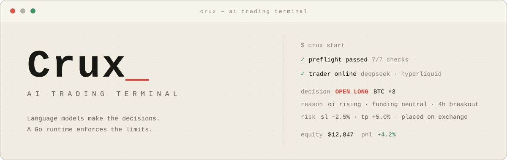

<p align="center">
  
</p>

<p align="center">
  <a href="https://github.com/NoFxAiOS/nofx/stargazers"></a>
  <a href="https://github.com/NoFxAiOS/nofx/releases"></a>
  <a href="https://github.com/NoFxAiOS/nofx/blob/main/LICENSE"></a>
</p>

<br/>

Crux is a self-hosted trading terminal for **US stocks** and **China A-shares**. A language model reads daily market data on each cycle and proposes buy, sell or hold decisions. Before any order is sent, a Go runtime checks the decision against the market's rules: whole lots, T+1 settlement, daily price limits, no shorting for A-shares, and the trading session.

**Status:** paper trading only. US orders go to an Alpaca paper account. A-share orders go to a built-in paper account. A live A-share broker is not connected yet.

## Markets

| Market | Symbols | Currency and clock | Data | Execution |
| :--- | :--- | :--- | :--- | :--- |
| US equities (`us_equity`) | `AAPL`, `BRK.B` | USD, US Eastern | Alpaca daily bars | Alpaca paper account |
| China A-shares (`cn_equity`) | `600519.SH`, `000001.SZ`, `830799.BJ` | CNY, Beijing | Tushare Pro daily bars (forward-adjusted) | Built-in paper account (commission and stamp duty) |

A-share rules the runtime enforces:

- Whole lots of 100 shares. An odd-lot sell is allowed only when it closes the whole position.
- T+1: shares bought today cannot be sold until the next trading day.
- No shorting and no leverage.
- Daily price limits: 10% main board, 20% ChiNext and STAR, 30% Beijing, 5% ST stocks.

US stocks may be shorted and accept fractional quantities. Leverage is not used.

## Quick start

1. Install and open the web app (see [Install](#install)).
2. Register. The first account becomes the owner of the instance.
3. **Add an AI model.** Any OpenAI-compatible endpoint works. Enter the base URL, model name and API key.
4. **Add an exchange account.**
   - For US stocks, choose `alpaca_paper` and enter your Alpaca paper key and secret.
   - For A-shares, choose `cn_paper` and enter your Tushare Pro token.
5. Create a strategy in **Strategy Studio**. Pick the symbols and the risk limits.
6. Create a trader that uses the strategy and the account, then start it.

The dashboard shows the equity curve, open positions, each AI decision with its reasoning, and the daily price for the first open position.

## Configuration

Copy `.env.example` to `.env` and set the required secrets:

| Variable | Purpose |
| :--- | :--- |
| `JWT_SECRET` | Signs login tokens. At least 32 characters. |
| `DATA_ENCRYPTION_KEY` | Base64 32-byte key. Encrypts stored API keys. |
| `RSA_PRIVATE_KEY` | Used for browser-to-server encryption. |
| `ALPACA_API_KEY`, `ALPACA_SECRET_KEY` | Optional server-wide Alpaca market-data keys. |
| `DB_TYPE`, `DB_PATH` | SQLite by default. Set `DB_TYPE=postgres` for PostgreSQL. |
| `EXPERIENCE_IMPROVEMENT` | Set to `false` to turn off anonymous usage statistics. |

Broker and data keys are normally entered in the web app per account, not in `.env`. The Tushare token is entered in the `cn_paper` account.

Paper account state is saved under `data/paper`.

## Install

**Linux / macOS**

```bash
curl -fsSL https://raw.githubusercontent.com/NoFxAiOS/nofx/main/install.sh | bash
```

Then open `http://127.0.0.1:3000`.

**Docker**

```bash
curl -O https://raw.githubusercontent.com/NoFxAiOS/nofx/main/docker-compose.prod.yml
docker compose -f docker-compose.prod.yml up -d
```

**From source** — Go 1.25+ and Node.js 18+:

```bash
git clone https://github.com/NoFxAiOS/nofx.git && cd nofx
cd server && go build -o crux && ./crux  # backend
cd web && npm install && npm run dev  # frontend, in a second terminal
```

**Update** — re-run the install script, or pull the new image and restart with `docker compose`.

## Architecture

| Path | Role |
| :--- | :--- |
| `server/trader/types` | Market definitions, capabilities and rules (lots, settlement, price limits, sessions) |
| `server/trader/cnpaper`, `server/trader/alpacapaper` | Paper brokers for A-shares and US stocks |
| `server/provider/tushare`, `server/provider/alpaca` | Market-data clients |
| `server/market` | Daily bars and indicators for the AI prompt |
| `server/kernel` | Prompt building and fail-closed validation of AI decisions |
| `server/store` | Database models (GORM, SQLite or PostgreSQL) |
| `server/api` | HTTP API used by the web app |
| `web/src/app` | Front-end entry point, router, header and footer |
| `web/src/features` | Feature folders: auth, traders, dashboard, strategy, faq, settings |
| `web/src/shared` | Shared UI, API client, i18n, types and config modals |

The migration plan and the decisions behind it are in [docs/plans/2026-10-14-cn-us-equity-migration.md](docs/plans/2026-10-14-cn-us-equity-migration.md).

## Testing

```bash
cd server && go test ./...
cd web && npx tsc --noEmit -p . && npx vitest run
```

## Documentation

| | |
| :--- | :--- |
| [Getting Started](docs/getting-started/README.md) | Setup steps and account configuration |
| [Migration plan](docs/plans/2026-10-14-cn-us-equity-migration.md) | A-share and US equity design |
| [Troubleshooting](docs/archive/guides/TROUBLESHOOTING.md) | Diagnosing common issues |

The FAQ inside the web app is the most current reference.

## Community

[Issues](https://github.com/NoFxAiOS/nofx/issues)

## Contributing

Code, documentation and bug reports are welcome. See the [Contributing Guide](CONTRIBUTING.md), [Code of Conduct](CODE_OF_CONDUCT.md) and [Security Policy](SECURITY.md).

Crux tracks meaningful contributions and intends to reward contributors as the ecosystem grows. Priority issues carry higher weight.

| Contribution      | Weight |
| :---------------- | :----: |
| Pinned Issue PRs  | ★★★★★★ |
| Code (Merged PRs) | ★★★★★  |
| Bug Fixes         |  ★★★★  |
| Feature Ideas     |  ★★★   |
| Bug Reports       |   ★★   |
| Documentation     |   ★★   |

<a href="https://github.com/NoFxAiOS/nofx/graphs/contributors">
  
</a>

## Sponsors

<a href="https://github.com/pjl914335852-ux"></a>
<a href="https://github.com/cat9999aaa"></a>
<a href="https://github.com/1733055465"></a>
<a href="https://github.com/kolal2020"></a>
<a href="https://github.com/CyberFFarm"></a>
<a href="https://github.com/vip3001003"></a>
<a href="https://github.com/mrtluh"></a>
<a href="https://github.com/cpcp1117-source"></a>
<a href="https://github.com/match-007"></a>
<a href="https://github.com/leiwuhen1715"></a>
<a href="https://github.com/SHAOXIA1991"></a>

[Become a sponsor](https://github.com/sponsors/NoFxAiOS)

<br/>

If Crux is useful to you, a star helps other traders find it.

[](https://star-history.dera.page/#NoFxAiOS/nofx&Date)

## License

[AGPL-3.0](LICENSE)

<sub>Automated trading involves substantial risk. AI-driven strategies are experimental and can lose money. This software is for paper trading and research. It is not investment advice.</sub>
