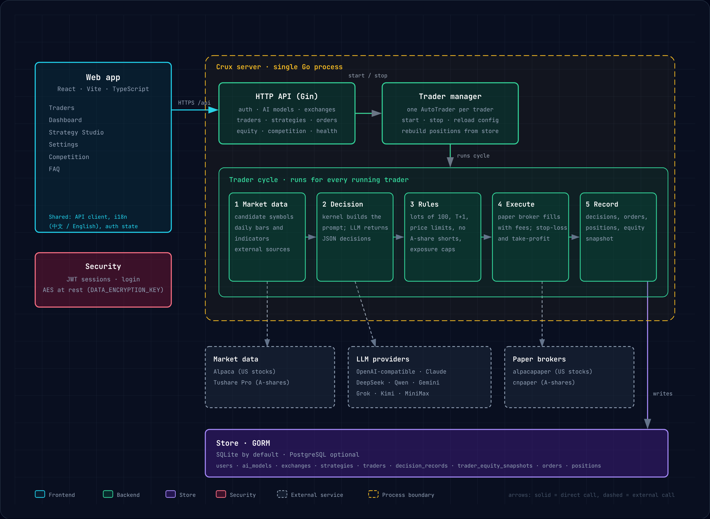

<p align="center">
  <b>中文</b> | <a href="README.en.md">English</a>
</p>

<p align="center">
  
</p>

<br/>

Crux 是一个自托管的交易终端，支持**美股**和**中国 A 股**。每个周期，大语言模型会读取日线行情数据，给出买入、卖出或持有的决策。在任何订单发出之前，Go 运行时会先按市场规则检查这项决策：整手交易、T+1 交收、每日涨跌停、A 股不允许做空，以及交易时段。

**状态：** 仅支持模拟交易。美股订单发送到 Alpaca 模拟账户，A 股订单发送到内置的模拟账户。目前尚未接入 A 股实盘券商。

## 市场

| 市场 | 代码示例 | 币种与时区 | 行情数据 | 交易执行 |
| :--- | :--- | :--- | :--- | :--- |
| 美股（`us_equity`） | `AAPL`、`BRK.B` | 美元，美东时间 | Alpaca 日线 | Alpaca 模拟账户 |
| 中国 A 股（`cn_equity`） | `600519.SH`、`000001.SZ`、`830799.BJ` | 人民币，北京时间 | Tushare Pro 日线（前复权） | 内置模拟账户（含佣金和印花税） |

运行时强制执行的 A 股规则：

- 以 100 股为一手。只有卖出时能清空整个仓位，才允许卖出零股。
- T+1：当日买入的股票，要到下一交易日才能卖出。
- 不允许做空，也不使用杠杆。
- 每日涨跌停：主板 10%，创业板和科创板 20%，北交所 30%，ST 股 5%。

美股可以做空，也接受小数股数。不使用杠杆。

## 快速开始

1. 安装并打开 Web 应用（见 [安装](#安装)）。
2. 注册。第一个账户会成为实例的所有者。
3. **添加 AI 模型。** 任何兼容 OpenAI 接口的端点都可以。填写 Base URL、模型名称和 API Key。
4. **添加交易所账户。**
   - 美股选择 `alpaca_paper`，填写 Alpaca 模拟账户的 Key 和 Secret。
   - A 股选择 `cn_paper`，填写 Tushare Pro 的 Token。
5. 在**策略工作室**中创建策略，选择标的并设定风控限制。
6. 创建一个使用该策略和账户的交易员，然后启动它。

仪表盘会显示权益曲线、当前持仓、每一条 AI 决策及其理由，以及第一个持仓标的的日线行情。

## 配置

复制 `.env.example` 为 `.env`，并填写必需的密钥：

| 变量 | 用途 |
| :--- | :--- |
| `JWT_SECRET` | 用于签发登录令牌。至少 32 个字符。 |
| `DATA_ENCRYPTION_KEY` | Base64 编码的 32 字节密钥，用于加密已保存的 API Key。 |
| `RSA_PRIVATE_KEY` | 用于浏览器与服务器之间的加密传输。 |
| `ALPACA_API_KEY`、`ALPACA_SECRET_KEY` | 可选，服务器级别的 Alpaca 行情密钥。 |
| `DB_TYPE`、`DB_PATH` | 默认使用 SQLite。设置 `DB_TYPE=postgres` 可改用 PostgreSQL。 |
| `EXPERIENCE_IMPROVEMENT` | 设为 `false` 可关闭匿名使用统计。 |
| `API_SERVER_PORT` | 从源码运行时的后端端口（默认 8080）。Docker 容器内始终使用 8080。 |
| `CORS_ALLOWED_ORIGINS` | 允许调用 API 的浏览器来源，逗号分隔；仅在 Web 应用与 API 不同源时需要。 |
| `AI_MAX_TOKENS` | 每次 AI 回复的最大 token 数。源码运行默认 2000，Docker 默认 8000。 |

券商和数据密钥通常在 Web 应用中按账户填写，而不是写在 `.env` 里。Tushare Token 填在 `cn_paper` 账户中。

模拟账户的状态保存在 `data/paper` 目录下。

## 安装

克隆仓库：

```bash
git clone https://github.com/zsjtiger/nofx.git && cd nofx
```

- **Docker：** 见 [Docker 部署](#docker-部署)。
- **源码运行：** 见 [本地开发](#本地开发)。

**更新：** 执行 `git pull`，然后 Docker 方式运行 `./start.sh start --build`，源码方式则重启后端和前端。

## 本地开发

环境要求：Go 1.25.11 或更高版本（如果本机没有，会自动下载 `server/go.mod` 中指定的工具链），Node.js 20 或更高版本，以及 Git。

### 1. 创建 `.env`

```bash
cp .env.example .env
```

设置三个密钥。缺少它们，服务器无法启动。

```bash
# JWT_SECRET：任意至少 32 个字符的随机字符串
openssl rand -base64 48

# DATA_ENCRYPTION_KEY：Base64 编码的 32 字节密钥
openssl rand -base64 32

# RSA_PRIVATE_KEY：单行 PEM 密钥，每个换行用 \n 表示
openssl genrsa -out key.pem 2048
awk 'NF{printf "%s\\n",$0}' key.pem
```

把输出分别填入 `.env` 中的 `JWT_SECRET=...`、`DATA_ENCRYPTION_KEY=...` 和 `RSA_PRIVATE_KEY=...`，然后删除 `key.pem`。`.env` 已被 git 忽略，请保持这一设置。

### 2. 启动后端

```bash
cd server
go run main.go          # 监听 http://localhost:8080
```

`main.go` 会从 `server/` 或仓库根目录读取 `.env`。首次启动会在当前目录下创建 `data/data.db`（SQLite）。等效的 Make 命令：`make run`。

### 3. 启动前端

在第二个终端中执行：

```bash
cd web
npm install
npm run dev             # http://127.0.0.1:3000
```

Vite 开发服务器会把 `/api` 代理到 `localhost:8080`，所以请保持后端运行。

### 4. 首次使用

打开 `http://127.0.0.1:3000`，注册第一个账户（它将成为所有者），然后按照[快速开始](#快速开始)操作。

### 常用操作

| 操作 | 命令 |
| :--- | :--- |
| 运行全部测试 | `make test`（或见 [测试](#测试)） |
| 仅运行后端测试 | `cd server && go test ./...` |
| 前端类型检查和测试 | `cd web && npx tsc --noEmit -p . && npx vitest run` |
| 构建后端二进制 | `cd server && go build -o crux`（或 `make build`） |
| 构建前端 | `cd web && npm run build`（或 `make build-frontend`） |
| 列出 Make 目标 | `make help` |

### 切换数据库

默认使用 SQLite。要改用 PostgreSQL，请在 `.env` 中设置 `DB_TYPE=postgres`，以及 `DB_HOST`、`DB_PORT`、`DB_USER`、`DB_PASSWORD`、`DB_NAME` 和 `DB_SSLMODE`。

服务器启动时会删除加密货币时代遗留的数据库列。修改 SQLite 数据库之前，会在数据库旁边写入一份备份，名为 `data.db.bak-<UTC 时间戳>`。

### 故障排查

| 报错信息 | 解决办法 |
| :--- | :--- |
| `config: JWT_SECRET is required` | 在 `.env` 中设置 `JWT_SECRET`，长度至少 32 个字符。 |
| `failed to load RSA private key` | 将 `RSA_PRIVATE_KEY` 设置为一行 PEM，并使用 `\n` 转义换行。 |
| `failed to load data encryption key` | 将 `DATA_ENCRYPTION_KEY` 设置为 Base64 编码的 32 字节值。 |
| 网页显示 API 错误 | 确认后端正在 8080 端口运行。 |

## Docker 部署

环境要求：安装了 Compose v2（`docker compose`）的 Docker。

服务栈包含两个服务：

| 服务 | 镜像 | 宿主机端口 | 作用 |
| :--- | :--- | :--- | :--- |
| `crux` | 由 `deploy/docker/Dockerfile.backend` 构建 | `CRUX_BACKEND_PORT`（默认 8080） | API 与交易引擎。数据保存在 `./data`。 |
| `crux-frontend` | 由 `deploy/docker/Dockerfile.frontend` 构建 | `CRUX_FRONTEND_PORT`（默认 3000） | 提供 Web 应用，并把 `/api` 代理到后端。 |

### 使用 `start.sh` 快速启动

```bash
git clone <this repository> && cd nofx
./start.sh start --build
```

首次运行时，`start.sh` 会用 `.env.example` 创建 `.env`，并生成缺失的 `JWT_SECRET`、`DATA_ENCRYPTION_KEY` 和 `RSA_PRIVATE_KEY`。随后构建镜像并启动两个服务。打开 `http://127.0.0.1:3000`，或者 `CRUX_FRONTEND_PORT` 设置的端口。

### 手动启动

```bash
cp .env.example .env    # 然后按本地开发第 1 步的说明设置三个密钥
docker compose up -d --build
docker compose ps       # 两个服务都应显示 healthy
```

### 管理服务栈

| 命令 | 作用 |
| :--- | :--- |
| `./start.sh start` | 启动服务。加上 `--build` 会重新构建镜像。 |
| `./start.sh stop` | 停止服务，数据保留。 |
| `./start.sh restart` | 重启服务。 |
| `./start.sh logs backend` | 持续查看后端日志。传入 `frontend` 查看 Web 服务器日志，不传则两者都看。 |
| `./start.sh status` | 显示服务状态。 |
| `./start.sh update` | 拉取最新代码并重新构建。 |
| `./start.sh clean` | **危险操作。** 删除容器和数据。 |
| `./start.sh regenerate-keys` | **危险操作。** 重新生成所有加密密钥。 |

等效的 Compose 命令：`docker compose logs -f crux`、`docker compose down`。

### 配置

在 `.env` 中设置以下变量：

| 变量 | 默认值 | 用途 |
| :--- | :--- | :--- |
| `CRUX_BACKEND_PORT` | `8080` | API 的宿主机端口。 |
| `CRUX_FRONTEND_PORT` | `3000` | Web 应用的宿主机端口。 |
| `TZ` | `Asia/Shanghai` | 容器时区，由 `docker-compose.yml` 读取。 |
| `AI_MAX_TOKENS` | `8000` | 每次 AI 回复的最大 token 数，覆盖 Docker 默认值。 |

容器使用 `./data` 保存数据库和模拟账户状态。

### 备份与升级

- **备份：** 先停止服务栈，然后复制 `.env` 和 `data/` 目录。没有原来的 `DATA_ENCRYPTION_KEY`，已保存的 API Key 将无法解密。
- **升级：** 执行 `git pull` 后运行 `./start.sh start --build`，或直接运行 `./start.sh update`。

### 健康检查

后端提供 `GET /api/health`，前端提供 `GET /health`。两者都被 compose 的健康检查使用。

## 架构

<p align="center">
  
</p>

| 路径 | 职责 |
| :--- | :--- |
| `server/trader/types` | 市场定义、能力与规则（整手、交收、涨跌停、交易时段） |
| `server/trader/cnpaper`、`server/trader/alpacapaper` | A 股与美股的模拟券商 |
| `server/provider/tushare`、`server/provider/alpaca` | 行情数据客户端 |
| `server/market` | 为 AI 提示词准备的日线数据和指标 |
| `server/kernel` | 提示词构建，以及对 AI 决策的失败即关闭（fail-closed）校验 |
| `server/store` | 数据库模型（GORM，SQLite 或 PostgreSQL） |
| `server/api` | Web 应用使用的 HTTP API |
| `web/src/app` | 前端入口、路由、头部和页脚 |
| `web/src/features` | 功能模块目录：认证、交易员、仪表盘、策略、FAQ、设置 |
| `web/src/shared` | 共享 UI、API 客户端、国际化、类型定义和配置弹窗 |

## 测试

```bash
cd server && go test ./...
cd web && npx tsc --noEmit -p . && npx vitest run
```
